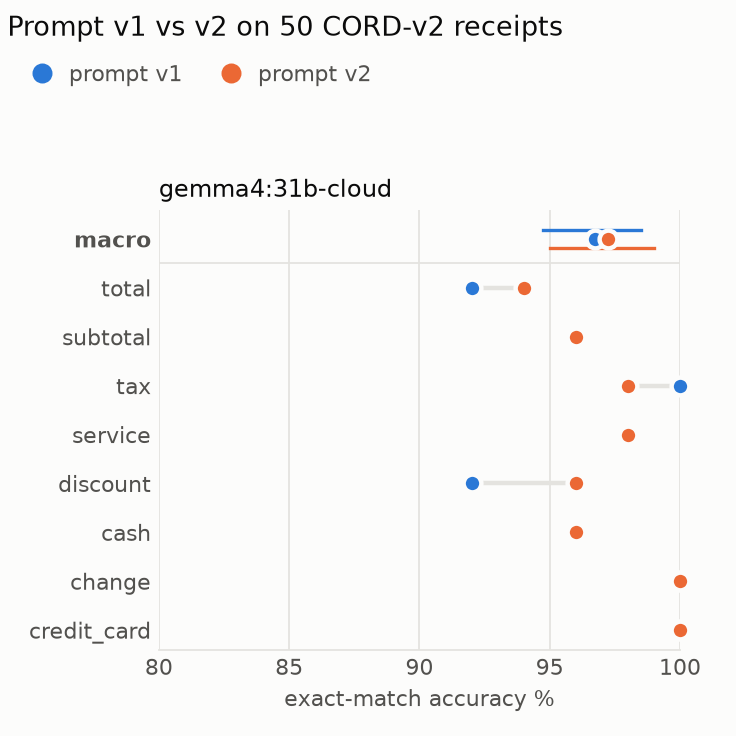

# llm-doc-extraction-eval

[](https://github.com/ricca200xx/llm-doc-extraction-eval/actions/workflows/ci.yml)

A small, strict evaluation harness for vision-language models that extract
structured fields from receipt images. It runs on the public
[CORD-v2](https://huggingface.co/datasets/naver-clova-ix/cord-v2) dataset, swaps
model backends through [LiteLLM](https://github.com/BerriAI/litellm), and reports
every number with a confidence interval, because on 50 documents a few points of
difference is usually noise.

The point is the measurement, not the model: a scorer that does not reward
guessing, a repair layer that does not invent values, and statistics that say
when a prompt change is real.

## What it does

```
receipt image ──► prompt v1 / v2 ──► LiteLLM ──► raw text ──► JSON repair ──► Pydantic schema
                                    (any model)                                     │
                         gold labels (CORD gt_parse) ──► strict per-field scorer ◄──┘
                                                             │
                              macro accuracy, macro F1, hallucination rate
                              bootstrap 95% CIs, paired McNemar + Holm
```

- **Schema** ([`schema.py`](src/docextract/schema.py)): 8 money fields of a
  receipt (`total`, `subtotal`, `tax`, `service`, `discount`, `cash`, `change`,
  `credit_card`). Every field is optional, and `null` means "not printed". In the
  50 receipts used here the fields are present between 5 and 47 times, so most
  fields have many documents where the right answer is `null`.
- **Extraction** ([`extract.py`](src/docextract/extract.py)): one LiteLLM call per
  receipt, temperature 0, the image as a base64 JPEG. The model string is the only
  thing that changes between a local Ollama model, Ollama Cloud, OpenAI, Anthropic
  or Gemini. Outputs are appended to JSONL as they arrive, so runs resume.
- **JSON repair** ([`repair.py`](src/docextract/repair.py)): strips code fences
  and surrounding prose, drops trailing commas, and closes output cut off by the
  token limit. It never keeps a half-written value: if the cut lands inside a
  string or after a number that may itself be partial, that member is dropped, so
  truncation counts as a miss rather than a wrong value.
- **Scorer** ([`scoring.py`](src/docextract/scoring.py)): strict exact match per
  field after number canonicalisation only (`Rp 60.000`, `60,000` and
  `60000.00` are the same amount; any different digit is wrong).

  | gold \ prediction | `null` | same value | other value |
  |---|---|---|---|
  | `null` | correct abstention | — | **hallucination: FP** |
  | value | miss: FN | TP | wrong value: FP + FN |

  Accuracy counts correct abstentions; F1 does not, so a model that answers
  everything is punished on F1 for every field it invents.
- **Statistics** ([`stats.py`](src/docextract/stats.py)): percentile bootstrap
  over documents (2,000 resamples, seeded) for 95% CIs; for the prompt
  comparison, a paired bootstrap of the macro difference plus an exact McNemar
  test per field with Holm correction across the 8 fields. Resampling is by
  document because fields of the same receipt are not independent.

## Results

50 receipts from the CORD-v2 test split, 8 fields each (400 field decisions per
run, 184 with a gold value and 216 where the right answer is `null`). Full tables,
including per-field McNemar and Holm-adjusted p-values, are in
[`results/report.md`](results/report.md); raw outputs are in
[`results/raw`](results/raw).

| Model | Prompt | Docs | Macro accuracy % [95% CI] | Macro F1 % [95% CI] | Hallucination rate % | Parse ok / repaired / failed | Median latency s |
|---|---|---:|---:|---:|---:|---:|---:|
| `ollama_chat/gemma4:31b-cloud` | v1 | 50 | 96.8 [94.8, 98.5] | 93.2 [87.4, 97.4] | 3.7 | 0 / 50 / 0 | 2.0 |
| `ollama_chat/gemma4:31b-cloud` | v2 | 50 | 97.2 [95.0, 99.0] | 94.2 [87.4, 98.8] | 1.9 | 0 / 50 / 0 | 1.8 |



*Dots are exact-match accuracy per field. On the macro row the horizontal lines
are 95% bootstrap confidence intervals over documents.*

What the numbers say:

- **Gemma 4 31B (Ollama Cloud) is already near the ceiling of this task.** Macro
  accuracy is 96.8% with prompt v1 and 97.2% with v2.
- **Prompt v2 did not measurably help.** The paired difference is +0.5 points of
  macro accuracy (95% CI -0.8 to +2.0) and +1.0 point of macro F1 (-1.3 to +4.0).
  No field changes significantly; the smallest raw McNemar p-value is 0.5. Reading
  the point estimates alone would have suggested an improvement that the data
  does not support.
- **v2 trades hallucinations for misses.** Invented values on `null` fields drop
  from 8 to 4 (of 216), but correct values drop from 179 to 177 (of 184): the
  stricter "use null" rule also makes the model abstain on two fields it used to
  get right.
- **Every raw output needed the repair layer.** The model wrapped all 100
  answers in markdown code fences, so a plain `json.loads` would have failed on
  every one; the repair layer recovered all of them. No output was truncated.
- **The remaining errors are mostly reading errors and label conventions**, not
  format problems: `377,859` read as `377,059`, and totals reported for receipts
  where CORD labels the same printed amount as a subtotal (see Limitations).

## How to run

Requires [uv](https://docs.astral.sh/uv/) and, for local models,
[Ollama](https://ollama.com).

```bash
git clone https://github.com/ricca200xx/llm-doc-extraction-eval
cd llm-doc-extraction-eval
uv sync
uv run pytest
```

Re-score the committed model outputs (no model or API key needed):

```bash
uv run docextract report
```

Run a model yourself. The first run downloads the CORD-v2 test split (~230 MB)
into `data/`.

```bash
ollama pull qwen2.5vl:3b
uv run docextract run --model ollama_chat/qwen2.5vl:3b --prompt v1 --n 50
uv run docextract run --model ollama_chat/qwen2.5vl:3b --prompt v2 --n 50
uv run docextract report
```

Any LiteLLM vision model works the same way, for example
`--model openai/gpt-4.1-mini` with `OPENAI_API_KEY` set, or
`--model gemini/gemini-2.5-flash` with `GEMINI_API_KEY`.

## Repository layout

```
src/docextract/
  schema.py    Pydantic schema + CORD key mapping
  data.py      CORD-v2 loader (pinned dataset revision)
  prompts.py   prompt v1 and v2
  extract.py   LiteLLM calls, resumable JSONL output
  repair.py    JSON repair for messy or truncated output
  scoring.py   strict per-field scorer, accuracy / F1 / hallucination rate
  stats.py     bootstrap CIs, McNemar, Holm
  report.py    tables, paired comparison, chart
tests/         pytest suite for repair, scorer and statistics
results/       raw model outputs (JSONL), report.md, summary.json, chart.png
```

## Limitations

- **Small sample.** 50 receipts, the first 50 of the CORD-v2 test split in file
  order. The confidence intervals are the honest summary: differences of one or
  two points between runs are inside them.
- **Low power per field.** An exact McNemar test needs at least 6 discordant
  documents, all in the same direction, to reach p < 0.05 before correction, and
  more after Holm. "Not significant" here means "not shown", not "no effect".
- **One run per configuration.** Temperature is 0, but hosted inference is not
  guaranteed to be deterministic, and run-to-run variance was not measured.
- **Strict scoring meets annotation conventions.** Some false positives are
  disagreements with how CORD labels a receipt, not invented numbers. Example:
  in `cord-test-009` the only printed amount is labelled `subtotal`, so a model
  that reports it as `total` is scored as hallucinating a total; in
  `cord-test-039` a card payment is labelled but no total is. I did not relabel
  anything, to avoid tuning the benchmark to the models.
- **Number canonicalisation is a choice.** The sign is ignored (`-60.000` and
  `60.000` match, because CORD writes discounts both ways), and one or two digits
  after the last separator are read as decimals while three are a thousands group.
- **Only scalar fields.** Line items (`menu`) are not scored. They need an
  alignment step between predicted and gold items, which this repo does not do.
- **One dataset, one language.** CORD receipts are Indonesian, photographed,
  mostly in one currency. Results say nothing about invoices, forms or IDs.
- **Prompt v2 was written once, before any run, and not tuned afterwards.** It
  is a test of the rules it adds, not the best prompt for either model.
- **Hosted model versions can change.** `gemma4:31b-cloud` is served by Ollama
  Cloud; the same tag may point to different weights later. The local model is
  the Q4 build from the Ollama library, run on an Apple M4 Pro (48 GB).
- **Failed calls.** A call that still fails after retries is scored as an empty
  prediction. In the committed runs every call eventually succeeded; two early
  attempts that failed are kept in the JSONL for the record and superseded by
  their retry.

## Data and license

Code: MIT. CORD-v2 is published by NAVER Clova under CC-BY-4.0
(Park et al., *CORD: A Consolidated Receipt Dataset for Post-OCR Parsing*, 2019).
The JSONL files in `results/raw` contain the gold labels of the 50 receipts used
here, copied from that dataset so the report can be rebuilt without downloading it.
